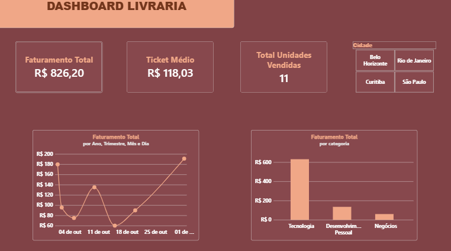

# 📚 Pipeline de Dados - Livraria

Projeto de Sistema de Vendas de uma Livraria.

---

## 🛠️ Tecnologias Utilizadas

* **Linguagem:** Python 3.13
* **Banco de Dados:** PostgreSQL
* **Dashboard:** Power BI
* **Bibliotecas Python:** (listadas no arquivo `requirements.txt`)

---

## 📊 Dashboard Interativo



---

## 📁 Estrutura do Projeto


```text
livraria-pipeline/
├── config/
│   └── database.py       # Conexões com o PostgreSQL
├── scripts/
│   └── popula_banco.py   # Script para inserção dos dados no banco
├── sql/
│   └── cria_tabelas.sql  # DDL para criação das tabelas e relacionamentos SQL
├── .env                  # Variáveis de ambiente
├── .gitignore            # Arquivos ignorados no versionamento
├── requirements.txt      # Dependências da aplicação
└── README.md             # Documentação do projeto
```

---

## ⚙️ Como Executar o Projeto 

Pré-requisitos
* ***Python 3.13 instalado***
* ***Instância ativa do PostgreSQL*** 
* ***Power BI Desktop (para visualização do painel)*** 

Passo a Passo
1. **Clonar o repositório:**
    git clone [https://github.com/seu-usuario/livraria-pipeline.git](https://github.com seu-usuario/livraria-pipeline.git)
cd livraria-pipeline

2. **Instalar as dependências:**
    pip install -r requirements.txt

3. **Configurar as Variáveis de Ambiente:**
Crie um arquivo `.env` na raiz do projeto contendo as credenciais de acesso ao PostgreSQL:
    DB_HOST=localhost
    DB_PORT=5432
    DB_NAME=livraria
    DB_USER=seu_usuario
    DB_PASSWORD=sua_senha

4. **Criar a Estrutura do Banco de Dados:**
Execute os scripts contidos em `sql/cria_tabelas.sql` na sua ferramenta de preferência (ex: pgAdmin, DBeaver ou psql) para criar o esquema das tabelas.

5. **Executar o Script de População:**
    python scripts/popula_banco.py

6. **Visualizar o Dashboard:**
Abra o relatório do Power BI conectado ao banco de dados PostgreSQL para consultar os indicadores atualizados.

---

## ✒️ Autora
Desenvolvido por Franciely Rebeca
